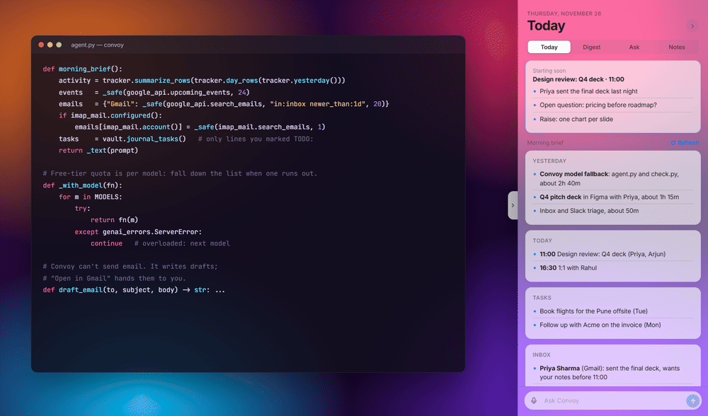
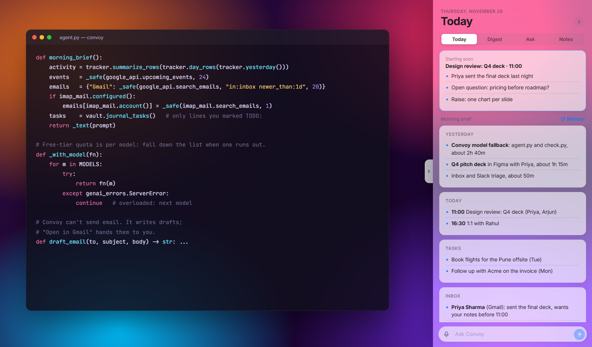
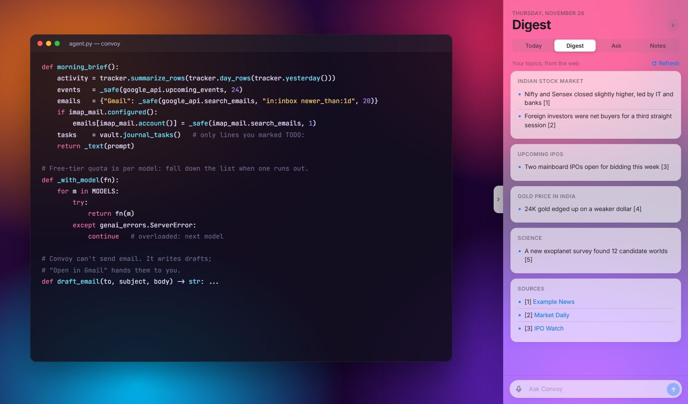
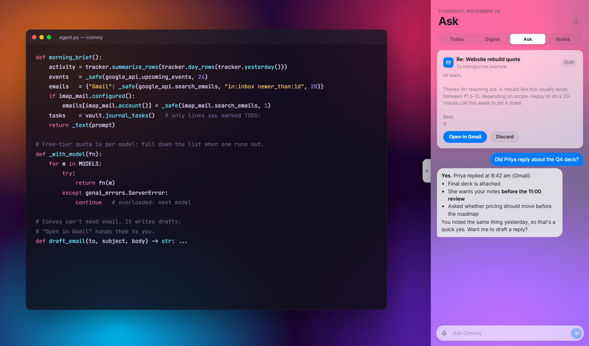
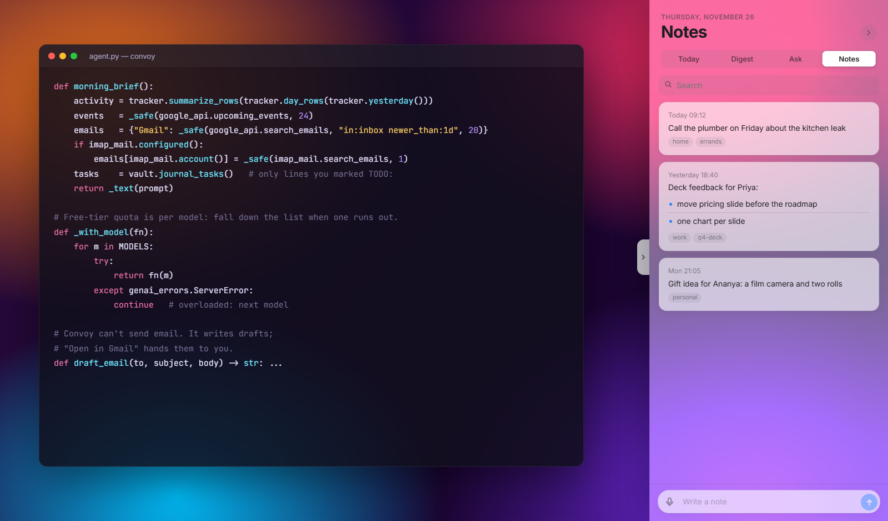
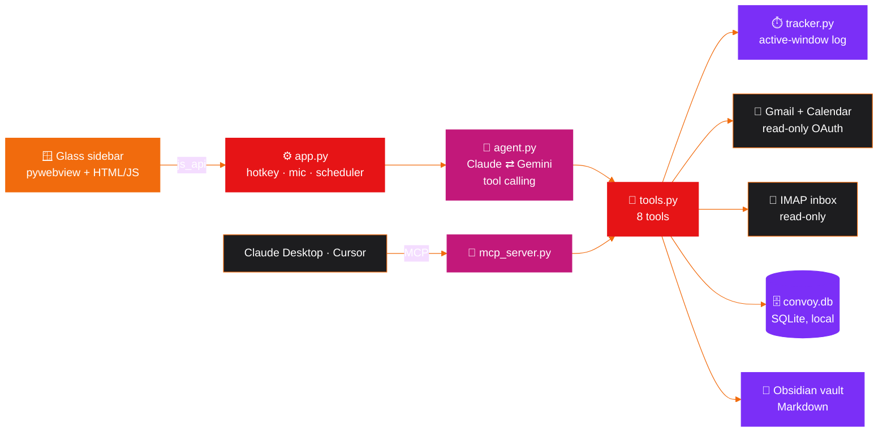

<div align="center">



<a href="#-what-it-does"></a>

<p>


<br>


</p>

**Convoy is a personal AI agent that lives on the edge of your screen.**<br>
A small arrow sits on the right side of your desktop. Click it, or press <kbd>Ctrl</kbd>+<kbd>Alt</kbd>+<kbd>Space</kbd>,<br>
and a frosted-glass sidebar slides in with your day already figured out.



<sub>Screens use made-up data. They're rendered from the real UI by <a href="docs/make_assets.py"><code>docs/make_assets.py</code></a>.</sub>

</div>

---

## ✨ What it does

<table>
<tr>
<td width="50%" valign="top">

### ☀️ Morning brief
What you **actually** worked on yesterday (from a local activity log), today's meetings, the tasks you marked in your journal, which emails need you, and 2–3 suggestions. Ready when you log in.

</td>
<td width="50%" valign="top">

### 📬 Two inboxes, zero sends
Reads **Gmail** (OAuth, read-only) and **any IMAP mailbox** (read-only, nothing gets marked as read). It writes drafts; **you** press Send in Gmail. It has no send permission at all.

</td>
</tr>
<tr>
<td valign="top">

### 💬 Ask anything
*"Did Priya reply?"*, *"What's on tomorrow?"*, *"How long was I in VS Code on Monday?"*: a tool-calling agent with 8 tools picks the right one, with the right Gmail query or date.

</td>
<td valign="top">

### 🎙️ Voice notes
Tap the mic and ramble in English, Hindi or both. Gemini hears the audio directly and returns a **clean note with tags**, using structured JSON output, not regex.

</td>
</tr>
<tr>
<td valign="top">

### 📅 Meeting prep
Ten minutes before a meeting, it pulls your recent emails with the attendees and your related notes, and writes a 30-second prep brief. No popup: a **red dot** appears on the arrow.

</td>
<td valign="top">

### 📰 Digest
Your topics (markets, IPOs, gold, science, anything) from the last 48 hours of Google News. Every bullet cites a numbered headline, and **real links are added by code**, so the model can't invent a URL.

</td>
</tr>
<tr>
<td valign="top">

### 🧠 Obsidian second brain
Every brief, note and meeting becomes a linked Markdown page in your vault: `Daily/`, `Notes/`, `Meetings/`, with attendees as `[[links]]`. Open the graph view and watch your weeks connect.

</td>
<td valign="top">

### 🔌 MCP server
The same 8 tools are exposed over the **Model Context Protocol**, so Claude Desktop, Claude Code or Cursor can ask *"what did I work on yesterday?"* too.

</td>
</tr>
</table>

## 📸 Screens

| Today | Digest | Ask | Notes |
|:--:|:--:|:--:|:--:|
|  |  |  |  |

## 🛠️ How it's made



<details open>
<summary><b>🧠 The agent: one set of tools, two models, two interfaces</b></summary>

- **Plain Python functions are the tools.** Type hints and docstrings become the tool schema, for Gemini's automatic function calling, Claude's `tool_runner` *and* the MCP server. There are no framework wrappers and no duplicated definitions.
- **Claude when you have it, Gemini when you don't.** Chat, the brief and meeting prep use Claude if `ANTHROPIC_API_KEY` is set. Any Claude outage, rate limit or empty balance falls back to Gemini, so the sidebar never breaks.
- **It survives the free tier.** Gemini's free daily quota is per model, so `_with_model()` works down `3.5-flash → 3.5-flash-lite → 2.5-flash → 2.5-flash-lite`. A model whose daily limit is used up is parked for an hour, and an overloaded one (503/504) is skipped for that call only. Chat history carries over when the model changes.
- **Cheap by design.** The brief and digest are generated once a day and cached in SQLite, and chat history resets daily so the context stays small.

</details>

<details>
<summary><b>🪟 The window: native Windows glass from Python</b></summary>

- `pywebview` renders the HTML UI. `glass.py` uses `ctypes` to call `SetWindowCompositionAttribute` for real **acrylic blur**, and sets `WS_EX_TOOLWINDOW` (hiding and re-showing the window so it takes effect) so Convoy never clutters the taskbar or Alt+Tab.
- A second tiny window is the **edge arrow**. Both are frameless, sized for your display scaling, and slide in and out.
- It's a single instance: launching Convoy again just opens the sidebar that's already running. It has its own `AppUserModelID` and icon, so Windows treats it as an app, not as "python".
- The UI is Apple-style: segmented control, inset cards, skeleton loaders, light and dark mode, `prefers-reduced-motion`. <kbd>Enter</kbd> sends, <kbd>Shift</kbd>+<kbd>Enter</kbd> adds a new line, and IME composition is respected.

</details>

<details>
<summary><b>🔒 Privacy and safety decisions</b></summary>

| Decision | How it's enforced |
|---|---|
| **It can never send email** | There's no `gmail.send` scope and no send code. Drafts open in Gmail's compose window, where you press Send. `check.py` asserts this. |
| **The second inbox is read-only** | IMAP `SELECT … readonly` + `BODY.PEEK`, and only the first 64 KB of each message is fetched (never whole attachments). Tested: the unread count doesn't change. |
| **Prompt-injection aware** | Email, calendar and web text is marked as untrusted data in every prompt. The UI escapes all model output before its tiny markdown renderer runs. |
| **The activity log stays local** | Only window titles are logged, never screenshots. Password managers, the lock screen and incognito/InPrivate windows are never recorded, and time after 5 idle minutes isn't counted. |
| **The journal stays private** | Only lines you mark `TODO:` or `- [ ]` reach the model. The rest of your diary never leaves the laptop. |
| **Sign-in never blocks the app** | OAuth is an explicit one-time command. The app never opens a browser flow itself (that once froze the brief for a whole morning). |

</details>

<details>
<summary><b>🧪 Tested and measured</b></summary>

- **`check.py`**: an offline self-check that needs no keys or network. It covers the activity summaries, privacy exclusions, the no-send guarantees, draft URLs, IMAP parsing (encoded headers, HTML to snippet, unread flags), Obsidian export (never overwrites), journal-task extraction, and model fallback on daily quota vs per-minute limits.
- **`evals/tool_eval.py`**: an eval of 12 prompts. Does the agent call the **right tool with the right arguments**: the right Gmail query, the right date, and *asking* for an address instead of guessing one? It prints a PASS/FAIL table and can compare Gemini and Claude on the same cases.

</details>

## 🧰 Built with

| Layer | Tech |
|---|---|
| Language | Python 3.12, vanilla HTML/CSS/JS (no build step) |
| Models | Google **Gemini** (`google-genai`, free tier) · Anthropic **Claude** (optional, `anthropic` tool runner) |
| Desktop | `pywebview` · Win32 via `ctypes` (acrylic, DPI, tool windows, idle time) · `keyboard` hotkey |
| Data | SQLite (stdlib) · Gmail + Calendar APIs · IMAP (stdlib `imaplib`) · Google News RSS |
| Voice | `sounddevice` + `numpy` → WAV → Gemini audio understanding → Pydantic-typed JSON |
| Integrations | Obsidian (Markdown files) · **MCP** server (`mcp`) |

About 1,200 lines of Python and one HTML file, with 10 dependencies.

## 🚀 Run it yourself

> Windows 10/11, Python 3.12. Cost: **₹0**. The Gemini free tier and Google APIs are free at personal-use volume.

```powershell
git clone https://github.com/rohancooks/convoy.git
cd convoy
python -m venv .venv
.venv\Scripts\pip install -r requirements.txt
copy .env.example .env          # then paste a free key from aistudio.google.com/apikey
.venv\Scripts\python check.py   # -> All checks passed.
.venv\Scripts\pythonw app.py    # the arrow appears on the right edge
```

<details>
<summary><b>Connect Gmail and Calendar (optional, ~10 min, one time)</b></summary>

1. In <https://console.cloud.google.com/>, create a project and enable the **Gmail API** and the **Google Calendar API**.
2. Set up the **OAuth consent screen**: External, Testing mode, and add your address as a test user.
3. Go to **Clients → Create client → Desktop app**, download the JSON, and save it as `credentials.json` (it's gitignored).
4. Sign in once with `.venv\Scripts\python google_api.py`. The scopes are read mail and read calendar only.

</details>

<details>
<summary><b>Everything else in <code>.env</code></b></summary>

| Variable | What it does |
|---|---|
| `GEMINI_API_KEY` | Required. Free from AI Studio. |
| `CONVOY_MODEL` / `CONVOY_FALLBACK_MODELS` | The main model and the list it falls down when quota runs out. `python agent.py models` lists what your key can use. |
| `ANTHROPIC_API_KEY`, `CLAUDE_MODEL` | Optional. Claude for chat, brief and meeting prep. |
| `DIGEST_TOPICS` | Topics separated by `;`. |
| `HOTKEY` | Defaults to `ctrl+alt+space`. |
| `EXCLUDE_APPS` | Apps the activity tracker never records. |
| `OBSIDIAN_VAULT` | Turns on the Markdown export. |
| `IMAP_HOST`, `IMAP_USER`, `IMAP_PASSWORD` | A second inbox, read-only. |
| `JOURNAL_SYNC` | A script to run before the brief that pulls your journal into the vault. |

To start Convoy at login, put a shortcut to `.venv\Scripts\pythonw.exe app.py` in `shell:startup`.
To use it from Claude Desktop, add `mcp_server.py` as an MCP server in `claude_desktop_config.json`.

</details>

## 🗂️ Project map

```text
convoy/
├── app.py            # windows, hotkey, mic, background meeting-prep loop
├── agent.py          # prompts, Claude ⇄ Gemini, model fallback, brief, digest, voice
├── tools.py          # the 8 tools (also served over MCP)
├── tracker.py        # active-window logger (Win32 via ctypes)
├── google_api.py     # Gmail + Calendar, read-only
├── imap_mail.py      # second inbox, read-only
├── vault.py          # Obsidian export + journal tasks
├── glass.py          # acrylic blur, DPI sizing, no taskbar button
├── db.py             # SQLite schema
├── mcp_server.py     # MCP server over tools.py
├── ui/               # index.html (sidebar) + handle.html (edge arrow)
├── check.py          # offline self-check
├── evals/            # tool-choice eval
└── docs/             # banner, screenshots, demo GIF + the script that makes them
```

## 🧭 Roadmap

- [ ] **Tauri shell**: the same `ui/` in a ~10 MB installer
- [ ] **Offline voice**: `faster-whisper` on-device instead of cloud audio
- [ ] **Semantic search** with `sqlite-vec` over notes and activity
- [ ] **Faithfulness eval**: synthetic days, checking the brief invents nothing

<div align="center">

<br>

**Built by [Rohan Thakur](https://rohanthakur.in)**: AI engineer, building agents that do real work.

<a href="https://rohanthakur.in"></a>
<a href="https://github.com/rohancooks"></a>


</div>
